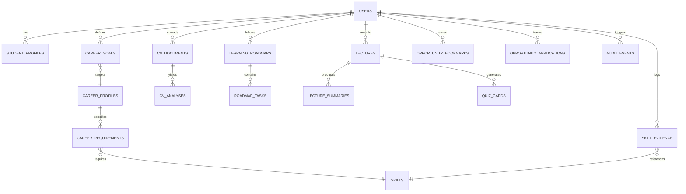

# FuturePath AI — Database Design Specification

## 1. Relational Schema Architecture

The database schema is normalized to 3NF and enforces referential integrity through foreign key constraints, unique indexes, and audit timestamps (`created_at`, `updated_at`).

## 2. Table Definitions

### 2.1 `users`
- `id` (Integer / UUID, Primary Key)
- `email` (String, Unique, Indexed)
- `hashed_password` (String, Not Null)
- `full_name` (String, Not Null)
- `role` (String, default: "student")
- `is_active` (Boolean, default: True)
- `created_at` (DateTime, Not Null)
- `updated_at` (DateTime, Not Null)

### 2.2 `student_profiles`
- `id` (Integer, Primary Key)
- `user_id` (Integer, Foreign Key -> users.id, Unique)
- `institution` (String)
- `degree` (String)
- `academic_year` (Integer)
- `weekly_study_hours` (Integer, default: 10)
- `bio` (Text)
- `github_url` (String)
- `linkedin_url` (String)
- `portfolio_published` (Boolean, default: False)
- `onboarding_completed` (Boolean, default: False)
- `created_at` / `updated_at` (DateTime)

### 2.3 `skills`
- `id` (Integer, Primary Key)
- `name` (String, Unique, Indexed)
- `category` (String: "languages", "frameworks", "databases", "cloud_devops", "fundamentals", "soft_skills")
- `description` (Text)

### 2.4 `skill_evidence`
- `id` (Integer, Primary Key)
- `user_id` (Integer, Foreign Key -> users.id)
- `skill_id` (Integer, Foreign Key -> skills.id)
- `evidence_type` (Enum: "self_reported", "cv_extracted", "project_evidence", "assessment_evidence", "course_completed")
- `proficiency_level` (Enum: "beginner", "intermediate", "advanced", "expert")
- `source_title` (String)
- `source_url` (String, Optional)
- `verified` (Boolean, default: False)
- `verified_at` (DateTime, Optional)
- `notes` (Text)
- `created_at` (DateTime)

### 2.5 `career_profiles`
- `id` (Integer, Primary Key)
- `slug` (String, Unique, Indexed)
- `title` (String, Not Null)
- `description` (Text)
- `market_demand` (String: "High", "Very High", "Emerging")
- `average_starting_salary` (String)
- `icon_name` (String)

### 2.6 `career_requirements`
- `id` (Integer, Primary Key)
- `career_id` (Integer, Foreign Key -> career_profiles.id)
- `skill_id` (Integer, Foreign Key -> skills.id)
- `importance` (Enum: "required", "preferred", "bonus")
- `minimum_level` (String: "beginner", "intermediate", "advanced")
- `weight` (Float: 1.0 to 3.0)

### 2.7 `cv_documents` & `cv_analyses`
- `cv_documents`: `id`, `user_id`, `filename`, `file_path`, `file_type`, `file_size`, `raw_text`, `uploaded_at`
- `cv_analyses`: `id`, `cv_id`, `target_career_id`, `extracted_skills` (JSON), `extracted_education` (JSON), `extracted_experience` (JSON), `extracted_projects` (JSON), `match_score` (Float), `missing_critical_skills` (JSON), `strengths` (JSON), `improvement_feedback` (JSON), `created_at`

### 2.8 `learning_roadmaps` & `roadmap_tasks`
- `learning_roadmaps`: `id`, `user_id`, `career_id`, `title`, `total_milestones`, `completed_milestones`, `is_active`, `created_at`
- `roadmap_tasks`: `id`, `roadmap_id`, `milestone_index`, `title`, `description`, `skill_id`, `estimated_hours`, `resource_url`, `resource_title`, `is_completed`, `completed_at`, `order_index`

### 2.9 `lectures`, `lecture_summaries`, `quiz_cards`
- `lectures`: `id`, `user_id`, `title`, `subject`, `media_type` (text/audio/transcript), `raw_content`, `created_at`
- `lecture_summaries`: `id`, `lecture_id`, `summary_text`, `key_concepts` (JSON), `action_items` (JSON)
- `quiz_cards`: `id`, `lecture_id`, `card_type` (quiz/flashcard), `question`, `answer`, `explanation`, `options` (JSON)

### 2.10 `opportunities`, `opportunity_bookmarks`, `opportunity_applications`
- `opportunities`: `id`, `title`, `organization`, `type` (internship/scholarship/hackathon/research), `location` (Sri Lanka / Remote / Global), `deadline`, `url`, `eligibility`, `description`, `tags` (JSON), `is_active`
- `opportunity_bookmarks`: `id`, `user_id`, `opportunity_id`, `created_at`
- `opportunity_applications`: `id`, `user_id`, `opportunity_id`, `status` (applied/interviewing/offered/rejected), `notes`, `applied_at`
